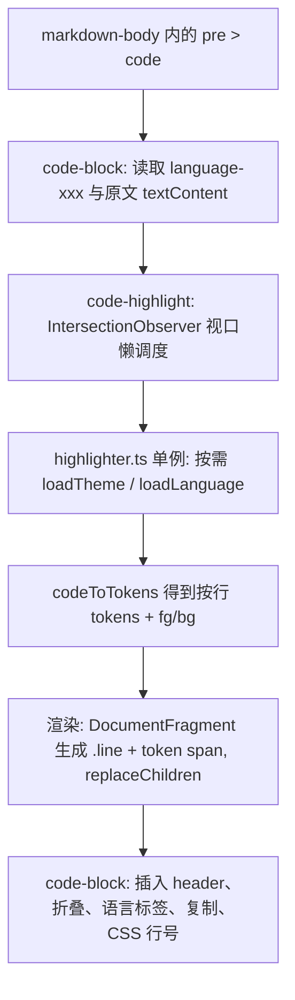
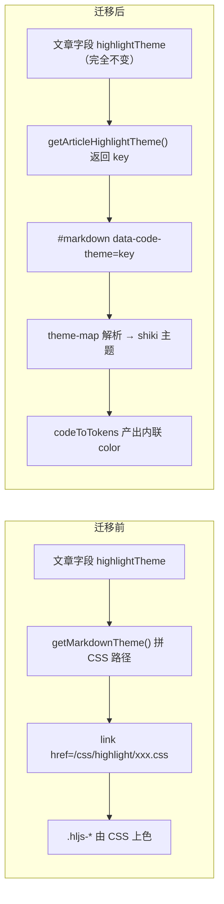

# 文章代码高亮方案更换（highlight.js → shiki）

> 状态：方案已全部定稿（§4.2 引擎、§4.3 语言覆盖、§4.4 主题三项决策已拍板），可直接进入实施
> 影响范围：`src/modules/article-content/`、`src/functions/`、`src/modules/head/`、`public/css/highlight/`、`public/css/markdown/scrolls-light.css`、`package.json`、`.github/copilot-instructions.md`

## 一、目标（原始诉求）

当前文章内容 `src/modules/article-content` 模块使用了 `highlight.js` 做代码高亮，同时自己通过脚本计算生成代码块的行号。为了提升性能和可维护性，计划更换为 `shiki`：

1. 保留当前的 UI 结构：顶部是 `.code-block-header`，展示折叠按钮、语言和复制代码按钮。
2. 使用 `shiki` 替代 `highlight.js`：`shiki` 的主题与语言语法都是按需动态 import 的懒加载，不需要像 `highlight.js` 那样在代码里写死语言白名单，可以支持任意语言的高亮。
3. 模块 `index` 中逻辑过多，参照 `src/modules/header` 的做法，把具体逻辑拆分到 `features/` 目录，`index` 只负责引入与初始化。
4. 保证代码高亮的性能优化，避免大文章出现卡顿。
5. 保持代码结构清晰、避免过度封装、注释齐全，每个函数与关键逻辑都有清晰说明。

## 二、现状盘点

### 2.1 代码侧

| 文件                                                                         | 现状                                                                                                                     | 问题                                                             |
| ---------------------------------------------------------------------------- | ------------------------------------------------------------------------------------------------------------------------ | ---------------------------------------------------------------- |
| [src/modules/article-content/index.ts](src/modules/article-content/index.ts) | 单文件内 `CodeBlock` 类（扫描 `pre`、高亮、拼 `.code-block-header`、折叠、语言标签、复制、行号）+ `medium-zoom` 灯箱逻辑 | 两类不相关逻辑混在一起；`pre` 全量同步高亮；行号靠字符串重写 DOM |
| [src/modules/article-content/hljs.ts](src/modules/article-content/hljs.ts)   | 静态注册 27 种语言                                                                                                       | 语言写死，未注册的语言无高亮；语言包全部进产物                   |
| [src/modules/head/markdown_theme.php](src/modules/head/markdown_theme.php)   | 输出 `base.css` + `getMarkdownTheme()`（文章主题 CSS + 高亮主题 CSS 的 `<link>`）                                        | 迁移后高亮主题不再由 CSS 文件提供                                |
| [src/functions/utils.php](src/functions/utils.php:418)                       | `getMarkdownTheme()` 内部计算 `$highlightTheme`（第 432 行）并拼 `/css/highlight/<key>.css` 输出 `<link>`（第 447 行）    | 抽成 `getArticleHighlightTheme()` 只返回 key，link 输出删除      |
| [src/functions/theme-config.php](src/functions/theme-config.php)             | `$markdownThemeMap`、`$defaultMarkdownThemeHighlightMap`、`$markdownHighlightMap`（18 个 key）                            | key 语义保留；注意 `vuepress → base16/tomorrow-night` 是悬空键   |
| [public/css/highlight/](public/css/highlight)                                | 18 个 `.hljs-*` 主题 CSS（合计 15.4 KB）；`github`/`juejin`/`smartblue`/`tomorrow-night` 四份**字节完全相同**，实际只有 15 种视觉；`smartblue` 未出现在 `$markdownHighlightMap` 中 | 迁移后整体废弃、删除                                             |
| [public/css/markdown/scrolls-light.css](public/css/markdown/scrolls-light.css) | 文件内嵌 **33 条 `.hljs-*` 规则**（完整一份 hljs github 主题，`bg #f8f8f8`）                                             | 迁移后全是死代码，本次一并清理                                   |
| [public/css/markdown/base.css](public/css/markdown/base.css:22)              | `.code-block-header*`、`.code-block-extension-code-line*` 等 UI 样式                                                     | UI 结构保留，选择器按新渲染结构做小幅调整                        |

### 2.2 现有渲染链路的性能问题

1. **全量同步高亮**：`init()` 里 `Array.from(article.querySelectorAll("pre"))` 逐个 `hljs.highlightElement()`，长文章一次性阻塞主线程。
2. **行号实现代价高**：`addLineNumber()` 读取 `codeDom.innerHTML` → `split("\n")` → `map` 拼字符串 → 整体写回 `innerHTML`，等于把刚生成的高亮 DOM 全部丢弃重建，既慢又容易破坏行内 HTML 结构。
3. **语言识别靠 class 字符串**：`getCodeLanguage()` 遍历 `classList` 找 `language-` 前缀，`cpp → c++` 靠手工 replace。
4. **无失败兜底**：语言未注册时 `hljs` 静默不高亮；没有"出错也不影响阅读"的保证。

### 2.3 迁移后需要保持不变的行为

- `pre > code` 的外层结构不变（`.code-block-header` 靠在 `pre` 内、`code` 前插入，`fold` 时用 `.code-block-header.fold + code { display: none }` 折叠）。
- 复制内容 = 纯代码文本，**不含行号**（现依赖"行号是 CSS 伪元素、不进 `textContent`"这一事实，必须继续成立）。
- 后台文章级字段 `markdownTheme` / `highlightTheme` 与主题级 `defaultMarkdownTheme` 取值不变，存量文章零迁移；`highlightTheme` 仍是唯一的高亮主题控制入口（详见 §4.8）。
- 语言标签、折叠状态、复制反馈等交互行为保持一致。

## 三、目标结构（features 拆分）

参照 `src/modules/header`（`index.ts` 只做 import + `new`）：

```
src/modules/article-content/
├── article-content.php          # 模板：新增 data-code-theme 属性（见 §5.2）
├── index.ts                     # 只 import + 初始化各 feature
├── style.scss                   # 文章样式（保留）+ 代码块颜色变量覆盖（见 §5.3）
└── features/
    ├── code-block/
    │   └── index.ts             # 代码块 UI 与交互：扫描 pre、header、折叠、语言标签、复制、行号
    ├── code-highlight/
    │   ├── index.ts             # 高亮调度：视口懒加载 + 调用 highlighter + 渲染 tokens
    │   ├── highlighter.ts       # shiki 单例封装（工厂 + 按需 loadTheme/loadLanguage + 兜底）
    │   ├── theme-map.ts         # 旧 highlightTheme key → shiki 主题 id 别名表 + resolveThemeId
    │   ├── themes/
    │   │   ├── index.ts         # shiki 主题登记表（键为 shiki 主题 id，供工厂查找）
    │   │   └── juejin.ts        # 自建主题对象：由旧 juejin.css 转写，色值零改动（见 §4.4.1）
    │   └── lang-map.ts          # 语言别名规范化 + 友好显示名
    └── image-zoom.ts            # medium-zoom 灯箱（现 index.ts 末尾逻辑平移）
```

职责边界（避免过度封装）：

- `code-block`：只负责 DOM 结构与用户交互，不碰 shiki。
- `code-highlight/index.ts`：对外只暴露两个函数 —— `prepareCodeHighlight(root)`（建 IO、开始懒加载）与 `highlightCodeBlock(codeEl, options)`（高亮单个块）；shiki 细节全部关在 `highlighter.ts`。
- `code-highlight/theme-map.ts`：对外只暴露 `resolveThemeId(key)`，内部做"旧 key → shiki 主题 id"的别名查表与未命中回落；调用方拿到的永远是 shiki 主题 id，不关心主题对象从哪来。
- `index.ts`：`import "./style.scss"`（含 `medium-zoom/dist/style.css`）→ `new CodeBlock()` → `initImageZoom()`，与 `header/index.ts` 风格一致。

## 四、关键技术决策

### 4.1 高亮流程



关键点：**不用 `codeToHtml`**，因为它的输出会带 shiki 自己的 `<pre class="shiki" style="background:...">` 外壳，与现有文章主题对 `.markdown-body pre > code` 的 padding/滚动条/背景定制冲突。改用 `highlighter.codeToTokens()` 拿结构化 tokens，自己渲染进现有 `code` 元素，UI 与样式链路几乎零改动。

原文读取时机：高亮前先取一次 `code.textContent`（此时 `code` 内只有服务端直出的纯文本，尚未插入 `.line` span），去掉末尾多余换行后交给 shiki；渲染完成即打上 `data-code-highlighted` 标记，保证不会二次读取已被 token 化的内容。

### 4.2 引擎选择（已定稿：Oniguruma WASM，JS 引擎预留在代码里注释）

TextMate 语法文件里的正则是为 **Oniguruma** 方言写的，浏览器要跑就得靠某个引擎解释它。两个内置引擎的真实成本（已实测）：

| 引擎 | 体积成本 | 兼容性 | 结论 |
| --- | --- | --- | --- |
| `createOnigurumaEngine(import("shiki/wasm"))` | 引擎代码 ≈16 KB（随代码分块）；**WASM 载荷 207 KB raw / 156 KB gzip**，位于独立 chunk，`import()` 懒加载，首屏不下载；v4 默认用 `wasm-inlined`（base64 内嵌在 JS 里），不额外发 `.wasm` 请求 | 原厂引擎，100% 兼容全部 360 门语法 | **采用** |
| `createJavaScriptRegexEngine()` | 0 额外下载 | shiki 3.9.1 起内置语言全支持；冷门写法偶有转换失败 | **代码预留、注释状态** |

`highlighter.ts` 里写成"一行切换"的形式：

```ts
import { createBundledHighlighter } from "shiki";
import { createOnigurumaEngine } from "shiki/engine/oniguruma";
// import { createJavaScriptRegexEngine } from "shiki/engine/javascript";

/**
 * @description: 正则引擎加载器（工厂层要求传"加载函数"，实例在创建时由 shiki 调用得到）
 * 默认用 Oniguruma WASM：兼容性最好，207 KB 载荷懒加载，不占首屏。
 * 切到 JS 引擎：注释上一行、解注释下一行，再改上面两行 import（WASM 那行也注释掉）。
 */
const loadEngine = () => createOnigurumaEngine(import("shiki/wasm"));
// const loadEngine = () => createJavaScriptRegexEngine({ forgiving: true });
```

注意切换时的三点：

- **`import("shiki/wasm")` 这行要一起切**：JS 引擎不需要 wasm，保留它会让 207 KB 载荷继续被打进产物（虽然不会被请求）。
- JS 引擎必须带 `{ forgiving: true }`，否则遇到无法转换的 Oniguruma 语法会直接抛错（默认 strict）；
- `forgiving` 的代价是"转换失败时静默降级"，可能出现高亮错位，切换后要抽查几门重量级语言（`cpp`、`typescript`、`php`）。
- JS 引擎的 `target` 默认 `auto`，在 ES2018+ 环境降级到 `u` 标志（项目 `build.target` 为 `es2015`，Vite 只降语法不改运行时，因此不影响，但仍需在目标浏览器实测）。

WASM 的初始化成本落在**首个代码块进入视口时**（懒加载触发），不在页面加载期；可在 `requestIdleCallback` 里做一次不阻塞的预热（见 §4.6 第 7 条）。

### 4.3 语言覆盖策略（已定稿：全量注册表）

`shiki/langs` 导出的 `bundledLanguages` 是一张"语言 id → `() => import("@shikijs/langs/xxx")`"的登记表。**登记多少，构建就会产出多少按需 chunk**，运行时只下载实际用到的那一个。

已实测的真实成本：

| 项 | 数值 |
| --- | --- |
| 语言总数 | **360 门**（`@shikijs/langs` 的 361 个 `.mjs`，另 361 个 `.d.mts` 是类型声明、不打进产物） |
| 语法文件总体积 | **8.19 MB**（平均 23 KB；`emacs-lisp` 774 KB、`cpp` 521 KB、`typescript` 186 KB、`python` 75 KB、`json` 3 KB） |
| 注册表本体 | `langs-bundle-full-*.mjs` **25.5 KB**（静态 import 进主 chunk，gzip 后约 6 KB） |
| 产物形态 | `dist/assets/` 下多出 **~360 个语言 chunk**（单页只请求 1 个） |
| zip 体积预估 | **+2.4 ～ 3.0 MB**（deflate 后，待 `pnpm build` 实测） |

采用全量后，语言查找表直接传注册表（**注意查找表里是懒加载函数，创建时不会预加载任何语言**，实际加载由 `loadLanguage` 触发）：

```ts
import { bundledLanguages } from "shiki/langs";

const createHighlighter = createBundledHighlighter({
	langs: bundledLanguages, // 全量 360 门，仅登记不加载
	// 需要回退到精选清单时改为显式映射（体积立刻回落）：
	// langs: { javascript: () => import("@shikijs/langs/javascript"), /* … */ },
	themes: bundledThemeTable, // 见 §4.4.2
	engine: loadEngine // 见 §4.2，工厂层要求"加载函数"
});
```

由此带来的两个**新增风险**（已写入 §九）：

1. **`dist/` 文件数从数百涨到近千**——`Typecho_Theme_JJ.zip` 文件条目翻倍，虚拟主机用户解压/FTP 上传更慢，属于可接受的既定代价。
2. **构建耗时上升**——Rolldown 要为 360 个动态 import 建 chunk，首次构建与 `pnpm dev` 冷启动会变慢，需在验收记录基线。

语言解析链（`lang-map.ts`）：

```
code.classList 里的 language-xxx
  → 小写化 + 别名规范化（c++ → cpp、html/xml 归一、sh/sh 与 bash/shell 归一…）
  → 命中 bundledLanguages（含其自带 aliases）：使用该 id；并记录友好显示名
  → 未命中 / 无语言：lang = "text"（纯文本，不抛错），语言标签显示原值或留空
```

shiki 的 `bundledLanguagesInfo` 自带 `name` / `aliases`，友好名直接取用，可删掉现有 `cpp → c++` 的硬编码 hack。全量注册下"未命中"只剩两种情况：**语法文件里压根没写语言**，或**用户写了个不存在的语言名**。

### 4.4 高亮主题：内置主题平替 + 自建 `juejin` 主题

**已确认的决策**：不做 100% 无损迁移，优先用 shiki 内置主题平替；**只有 `juejin`**（默认主题、曝光最高）保留现有视觉，转写为自定义 shiki 主题对象。

决策依据（已核对 shiki 4.6.0 的 65 个内置主题，逐个读取 `editor.background` / `editor.foreground`）：

- 65 个主题里 **没有任何一个**背景是 `#f8f8f8`（最接近的是 `#fff` 与 `#fafafa`），而 `juejin` 正是 `#f8f8f8 / #333`。
- `juejin.css` 的色值即 hljs 9.x 时代的 `github` 主题；shiki 的 `github-light` 是 VSCode 版（`#fff / #24292e`），token 配色也不一样，所以"找同名主题直接换"不成立。
- `public/css/highlight/` 下 18 个文件里 `github` / `juejin` / `smartblue` / `tomorrow-night` **字节完全相同**，实际只有 15 种视觉。

映射表（`theme-map.ts` 的纯数据部分）：

| 旧 key（存量 `fields.highlightTheme` 取值） | 目标主题                    | 来源   | 现状 bg / fg → 目标 bg / fg      | 说明                                |
| ------------------------------------------- | --------------------------- | ------ | -------------------------------- | ----------------------------------- |
| `juejin`（默认）                            | `juejin`（自建）            | 自定义 | `#f8f8f8` / `#333` → 完全一致    | 唯一保真项，见下方 `ThemeRegistration` |
| `github`                                    | `github-light`              | 内置   | `#f8f8f8` → `#fff`               | 同源，底色变白                      |
| `github-gist`                               | `github-light`              | 内置   | `#fff` / `#333` → `#fff` / `#24292e` | 近似                            |
| `atom-one-dark`                             | `one-dark-pro`              | 内置   | `#282c34` / `#abb2bf` → 完全一致 | 同源（Atom One Dark）               |
| `atom-one-light`                            | `one-light`                 | 内置   | `#fafafa` / `#383a42` → 完全一致 | 同源（Atom One Light）              |
| `monokai`                                   | `monokai`                   | 内置   | `#272822` 一致；fg `#ddd` → `#f8f8f2` | 同源                           |
| `monokai-sublime`                           | `monokai`                   | 内置   | `#23241f` → `#272822`            | 近似                                |
| `srcery`                                    | `gruvbox-dark-hard`         | 内置   | `#1c1b19` → `#1d2021`            | 深色暖色近似                        |
| `tomorrow`                                  | `github-light-default`      | 内置   | `#fff` / `#4d4d4c` → `#fff` / `#1f2328` | 近似                          |
| `tomorrow-night-blue`                       | `github-dark-default`       | 内置   | `#002451` → `#0d1117`            | 近似                                |
| `tomorrow-night-eighties`                   | `github-dark-dimmed`        | 内置   | `#2d2d2d` → `#22272e`            | 近似                                |
| `tomorrow-night`                            | `github-light`              | 内置   | 该文件与 `github.css` 同字节     | 现状就是浅色，勿映射成深色          |
| `smartblue`                                 | `github-light`              | 内置   | 该文件与 `github.css` 同字节     | 该 key 不在下拉列表中，仅兜底       |
| `atelier-sulphurpool-light`                 | `snazzy-light`              | 内置   | `#f5f7ff` → `#FAFBFC`            | 浅色冷调近似                        |
| `androidstudio`                             | `material-theme-darker`     | 内置   | `#282b2e` → `#212121`            | 深灰近似                            |
| `a11y-dark`                                 | `github-dark-high-contrast` | 内置   | `#2b2b2b` → `#0a0c10`            | 高对比语义一致                      |
| `a11y-light`                                | `github-light-high-contrast`| 内置   | `#fefefe` → `#ffffff`            | 高对比语义一致                      |
| `zenburn`                                   | `slack-dark`                | 内置   | `#3f3f3f` → `#222222`            | 低对比近似                          |
| `vuepress`                                  | `github-dark`               | 内置   | 现状悬空 404（`base16/tomorrow-night` 无此文件） | 顺手修掉该历史 bug      |
| `''`（选"无"）/ 其它未命中                  | 按 `$defaultMarkdownThemeHighlightMap` 推导；仍无则 `juejin` | — | —                    | 与现有语义一致                      |

体积核算：上表命中 **14 个内置主题 chunk**（`github-light` / `github-light-default` / `github-light-high-contrast` / `github-dark` / `github-dark-default` / `github-dark-dimmed` / `github-dark-high-contrast` / `one-dark-pro` / `one-light` / `monokai` / `gruvbox-dark-hard` / `snazzy-light` / `material-theme-darker` / `slack-dark`），合计 **≈256 KB raw / ≈44 KB gzip**（已逐个实测）；另加自建 `juejin` 主题（约 1–2 KB，直接进主包）。**单个页面只会加载命中的那 1 个**（2–6 KB gzip），不影响首屏。

#### 4.4.1 自建 `juejin` 主题（保真）

shiki 支持直接注册自定义主题对象（VS Code TextMate 主题格式），与内置主题混用同一个 `themes` 映射即可（`ThemeInput = ThemeRegistrationAny | DynamicImportThemeRegistration`）。做法是把旧 CSS 的每个 `.hljs-*` 选择器组按 TextMate scope 归位、色值原样搬运：

```ts
// src/modules/article-content/features/code-highlight/themes/juejin.ts
import type { ThemeRegistration } from "shiki";

/**
 * @description: 由旧 public/css/highlight/juejin.css 逐个选择器组转写而来，色值零改动
 * 旧文件即 hljs 9.x 的 github 主题；.hljs-xxx 类名 → TextMate scope 的归位表见文件头注释
 */
export const juejinTheme: ThemeRegistration = {
	name: "juejin",
	type: "light",
	bg: "#f8f8f8",
	fg: "#333",
	settings: [
		{ scope: ["comment", "punctuation.definition.comment", "string.comment"], settings: { foreground: "#998", fontStyle: "italic" } },
		{ scope: ["keyword", "storage", "storage.type", "keyword.control"], settings: { foreground: "#333", fontStyle: "bold" } },
		{ scope: ["constant", "constant.numeric", "constant.language", "variable.language", "variable.other"], settings: { foreground: "teal" } },
		{ scope: ["string", "punctuation.definition.string", "meta.diff.header"], settings: { foreground: "#d14" } },
		{ scope: ["entity.name.function", "entity.name.type", "support.type", "entity.name.class"], settings: { foreground: "#458", fontStyle: "bold" } },
		{ scope: ["entity.name.tag", "meta.tag", "entity.other.attribute-name"], settings: { foreground: "navy" } },
		{ scope: ["string.regexp", "markup.underline.link"], settings: { foreground: "#009926" } },
		{ scope: ["support.function", "support.class", "support.constant"], settings: { foreground: "#0086b3" } },
		{ scope: ["constant.other.symbol", "punctuation.definition.list"], settings: { foreground: "#990073" } },
		{ scope: ["markup.deleted"], settings: { background: "#fdd" } },
		{ scope: ["markup.inserted"], settings: { background: "#dfd" } },
		{ scope: ["markup.bold"], settings: { fontStyle: "bold" } },
		{ scope: ["markup.italic"], settings: { fontStyle: "italic" } }
	]
};
```

- 唯一有损点：`.hljs-comment` 这类类名反推 TextMate scope 时，个别次级 scope（如 `entity.name.function` vs `entity.name.class`）会落到同色，肉眼基本无感。
- 色值一律沿用旧 CSS（含 `teal`、`navy` 这类命名色，shiki 支持任意 CSS 颜色值），所以是**真·保真**，不是"接近"。
- 主题对象无需 `import()` 懒加载，直接随模块主包进入，`juejin` 页面零额外请求。

#### 4.4.2 混用与回落（注意：**旧 key ≠ shiki 主题名**）

`createBundledHighlighter` 的 `themes` 是一张**以 shiki 主题 id 为键**的查找表；而 `codeToTokens({ theme })` 里的字符串必须是主题注册时的 `name`（各内置主题的 `name` 与其 id 一致，已逐个核对）。因此不能直接把"旧 key → 主题"做成一层表，否则 `github` 会查不到 `github-light`。设计成两层：

```ts
// themes/index.ts —— 第 1 层：登记表，键必须是 shiki 主题 id
export const bundledThemeTable = {
	juejin: juejinTheme, // 自定义对象，name 为 "juejin"
	"github-light": () => import("@shikijs/themes/github-light"),
	"github-light-default": () => import("@shikijs/themes/github-light-default"),
	"github-light-high-contrast": () => import("@shikijs/themes/github-light-high-contrast"),
	"github-dark": () => import("@shikijs/themes/github-dark"),
	"github-dark-default": () => import("@shikijs/themes/github-dark-default"),
	"github-dark-dimmed": () => import("@shikijs/themes/github-dark-dimmed"),
	"github-dark-high-contrast": () => import("@shikijs/themes/github-dark-high-contrast"),
	"one-dark-pro": () => import("@shikijs/themes/one-dark-pro"),
	"one-light": () => import("@shikijs/themes/one-light"),
	"monokai": () => import("@shikijs/themes/monokai"),
	"gruvbox-dark-hard": () => import("@shikijs/themes/gruvbox-dark-hard"),
	"snazzy-light": () => import("@shikijs/themes/snazzy-light"),
	"material-theme-darker": () => import("@shikijs/themes/material-theme-darker"),
	"slack-dark": () => import("@shikijs/themes/slack-dark")
};

// theme-map.ts —— 第 2 层：纯数据别名表，旧 key → shiki 主题 id（与 §4.4 的表格一一对应）
const THEME_ALIAS = {
	juejin: "juejin",
	github: "github-light",
	"github-gist": "github-light",
	"atom-one-dark": "one-dark-pro",
	"atom-one-light": "one-light",
	monokai: "monokai",
	"monokai-sublime": "monokai",
	srcery: "gruvbox-dark-hard",
	tomorrow: "github-light-default",
	"tomorrow-night-blue": "github-dark-default",
	"tomorrow-night-eighties": "github-dark-dimmed",
	"tomorrow-night": "github-light",
	smartblue: "github-light",
	"atelier-sulphurpool-light": "snazzy-light",
	androidstudio: "material-theme-darker",
	"a11y-dark": "github-dark-high-contrast",
	"a11y-light": "github-light-high-contrast",
	zenburn: "slack-dark",
	vuepress: "github-dark"
} as const;

/**
 * @description: 把后台 key 解析为 shiki 主题 id，未命中回落 juejin
 */
export function resolveThemeId(key: string | null | undefined): string {
	return key && key in THEME_ALIAS ? THEME_ALIAS[key as keyof typeof THEME_ALIAS] : "juejin";
}
```

运行时**只有命中那一个主题会被 `loadTheme` 拉取**（查找表里的 `import()` 不会提前执行），未命中则回落 `juejinTheme` 并 `console.warn` 一次。

#### 4.4.3 高亮器创建方式（工厂两段式，别写成一次性）

`createBundledHighlighter` 返回的是**一个创建函数**，而不是 highlighter 实例；查找表里的语言/主题不会预加载，必须在创建后按需 `loadLanguage` / `loadTheme`：

```ts
const createHighlighter = createBundledHighlighter({
	langs: bundledLanguages, // 全量查找表（360 门，仅登记、不预加载）
	themes: bundledThemeTable, // 只登记 §4.4 命中的 14 个内置主题 + 自建 juejin
	engine: loadEngine // 工厂选项要求"加载函数"，见 §4.2
});

let highlighterPromise: Promise<HighlighterGeneric<any, any>> | undefined;

function getHighlighter() {
	// 空数组：创建时不加载任何语言/主题，全部按需
	return (highlighterPromise ??= createHighlighter({ langs: [], themes: [] }));
}

async function highlight(code: string, langId: string, themeId: string) {
	const highlighter = await getHighlighter();
	await Promise.all([highlighter.loadTheme(themeId), highlighter.loadLanguage(langId)]);
	return highlighter.codeToTokens(code, { lang: langId, theme: themeId });
}
```

（`engine` 是工厂选项，shiki 内部对每层分别处理：工厂层传函数、创建层可传实例/ Promise；`createBundledHighlighter` 在创建时会调用工厂层那个函数。故写成 `const loadEngine = () => createOnigurumaEngine(import("shiki/wasm"))` + `engine: loadEngine`。）

### 4.5 行号方案

shiki 的 `codeToTokens()` 返回**按行的二维数组**，行号不需要再切字符串：

- 渲染时每行输出 `<span class="line" data-line-num="N">`，行与行之间插入文本节点 `"\n"`（保证 `textContent` 与原文一致，复制内容正确）。
- 样式沿用现有 `::before { content: attr(data-line-num) }` 思路，[public/css/markdown/base.css](public/css/markdown/base.css:88) 里 `.code-block-extension-code-line` 选择器改为 `.line`，`.code-block-extension-code-show-num` 改为 `code.has-line-number`（3 条规则内的小改动）。
- 行号仍是伪元素渲染，**不进 `textContent`**，`src/utils/copy.ts` 的复制契约不变。

### 4.6 性能策略

1. **单例 + 缓存**：`highlighter.ts` 内部维护 `let highlighterPromise`，`createBundledHighlighter({ langs, themes, engine })` 只创建一次**工厂函数**，再由 `getHighlighter()` 以空 `langs`/`themes` 创建实例（见 §4.4.3）；`loadTheme` / `loadLanguage` 幂等，重复调用直接复用（并发调用用同一个 promise 去重）。
2. **视口懒加载**：`IntersectionObserver`（`rootMargin: "200px 0px"`）监听每个代码块，进入视口才高亮；未高亮前页面显示服务端直出的纯文本，无加载态、无闪烁。折叠（`display: none`）状态下的代码块天然不进入视口，展开后才高亮。项目已有 [src/utils/observer.ts](src/utils/observer.ts) 可复用，也可直接用原生 IO（该 util 支持多回调订阅，适合此处）。
3. **让出主线程**：逐块处理，每块之间 `await` 一次让出（`requestIdleCallback`，降级 `setTimeout(0)`，即 `yieldToMain()`），避免连续 tokenize 形成长任务。
4. **一次成型的 DOM 写入**：用 `DocumentFragment` 拼好整块内容后 `code.replaceChildren(fragment)`，不做多次 `append`/`innerHTML` 往返。
5. **不引入高亮中间态**：不先 `hljs` 再 `shiki`，也不做二次遍历。
6. **可选（不在本次范围）**：单块超长代码（如 >2000 行）可做分片高亮或 Web Worker，先以实测数据决定是否需要。
7. **WASM 预热**：Oniguruma 引擎是 `import("shiki/wasm")` 懒加载的（207 KB raw / 156 KB gzip），首次需要时才开始下载。可在首屏空闲时用 `requestIdleCallback` 提前 `import("shiki/wasm")`（只加载不初始化 highlighter），把下载与 CPU 代价挪出首屏长任务窗口；失败则静默忽略，不影响正常触发流程。

### 4.7 兜底与容错

- 语言/主题 chunk 加载失败、`codeToTokens` 抛错：捕获后保留纯文本，`console.warn` 一次，不打断阅读、不阻塞后续代码块。
- `pre` 无 `code` 子元素、`code` 为空、`pre` 已处理过（用 `data-code-highlighted` 标记幂等）：直接跳过。
- 语言为 `"text"` 时按纯文本处理，仍渲染行号与 header。

### 4.8 主题控制链路：`$highlightTheme` 语义不变，只换消费方

这是本次迁移的**对外行为契约**：后台"文章代码块主题"下拉框（`themeFields()` 里的 `highlightTheme`）依旧是唯一控制入口，字段名、18 个 key、优先级链全部不变，改的只是"谁去消费它"。



优先级链保持原样：

```
文章 fields.highlightTheme（非空）
  → 空（选"无"）时取 $defaultMarkdownThemeHighlightMap[getArticleTheme()]
  → 该文章主题未配置映射 → juejin
```

三处需要注意的行为差异：

| 场景                     | 迁移前                                           | 迁移后                                      |
| ------------------------ | ------------------------------------------------ | ------------------------------------------- |
| 值命中 18 个 key         | 加载对应 CSS 文件                                | 加载对应 shiki 主题（内置懒加载 / 自建直出） |
| 值未命中（脏值、旧路径） | 拼出 404 CSS，静默无高亮样式                     | 回落 `juejinTheme`，**仍正常高亮**，仅 warn  |
| 新增一个主题             | 往 `public/css/highlight/` 放 CSS 即可，无需构建 | 需在 `theme-map.ts` 加一行 + 重建（见 §十-3） |

`getMarkdownTheme()` 迁移后**只输出文章主题 CSS**，不再参与高亮主题计算；高亮 key 的唯一出口是 `getArticleHighlightTheme()`，避免同一逻辑两处各算一遍造成漂移。

## 五、改动明细

### 5.1 删除/新增文件

| 操作 | 路径                                                                                            | 说明                                                                            |
| ---- | ----------------------------------------------------------------------------------------------- | ------------------------------------------------------------------------------- |
| 删除 | `src/modules/article-content/hljs.ts`                                                           | 语言白名单废弃                                                                  |
| 删除 | `public/css/highlight/*.css`（18 个文件 / 15 种视觉）                                            | hljs 主题 CSS 整体废弃                                                          |
| 新增 | `src/modules/article-content/features/code-block/index.ts`                                      | UI 与交互                                                                       |
| 新增 | `src/modules/article-content/features/code-highlight/{index,highlighter,theme-map,lang-map}.ts` | 高亮链路                                                                        |
| 新增 | `src/modules/article-content/features/code-highlight/themes/juejin.ts`                          | 自建 `juejin` 主题对象（由旧 CSS 转写，保真）                                   |
| 新增 | `src/modules/article-content/features/code-highlight/themes/index.ts`                           | shiki 主题登记表（键为 shiki 主题 id，14 内置 + 自建 juejin，见 §4.4.2）        |
| 新增 | `src/modules/article-content/features/image-zoom.ts`                                            | 灯箱逻辑平移                                                                    |
| 重写 | `src/modules/article-content/index.ts`                                                          | 只做引入与初始化                                                                |
| 修改 | `public/css/markdown/base.css`                                                                  | 行号/高亮类选择器对齐新渲染结构                                                 |
| 修改 | `public/css/markdown/scrolls-light.css`                                                         | 删除文件内嵌的 33 条 `.hljs-*` 死规则                                           |
| 修改 | `src/modules/article-content/style.scss`                                                        | 代码块 `--code-block-bg/fg` 覆盖（见 5.3）                                      |
| 修改 | `package.json`                                                                                  | 移除 `highlight.js`，新增 `shiki`（^4.6.0，与现有依赖风格一致）                 |
| 修改 | `src/modules/article-content/article-content.php`                                               | `#markdown` 增加 `data-code-theme`                                              |
| 修改 | `src/functions/utils.php`                                                                       | 新增 `getArticleHighlightTheme()`；`getMarkdownTheme()` 不再输出 highlight link |
| 修改 | `src/modules/head/markdown_theme.php`                                                           | 同上（只保留 `base.css` 与文章主题 CSS）                                        |
| 修改 | `.github/copilot-instructions.md`                                                               | 技术栈一行的 `highlight.js` → `shiki`                                           |
| 修改 | `src/functions/theme-config.php`                                                                | 更新后台选项描述文案；key 全部保留，`vuepress` 悬空值修正                        |

### 5.2 PHP 侧最小改动

```php
// src/functions/utils.php —— 归一化出"逻辑高亮主题 key"（沿用旧取值，零迁移）
function getArticleHighlightTheme($that)
{
    global $defaultMarkdownThemeHighlightMap;
    $fields = parseFields($that->fields);   // 统一走 parseFields，兼容 Typecho 1.3 的对象形态
    $articleTheme = getArticleTheme($that); // 复用现有文章主题归一化逻辑
    $highlightTheme = isset($fields['highlightTheme']) ? $fields['highlightTheme'] : '';
    if (empty($highlightTheme)) {
        $highlightTheme = array_key_exists($articleTheme, $defaultMarkdownThemeHighlightMap)
            ? $defaultMarkdownThemeHighlightMap[$articleTheme]
            : 'juejin';
    }
    return $highlightTheme;
}
```

```php
<!-- src/modules/article-content/article-content.php -->
<div id="markdown" class="article-content-markdown markdown-body"
     data-code-theme="<?php echo headEscape(getArticleHighlightTheme($this)); ?>">
```

`getMarkdownTheme()` 中删除 `$highlightHref` / `$highlightLink` 相关代码；同时把 `vuepress` 的 `base16/tomorrow-night` 悬空值修正为 `github-dark`（见 §4.4 映射表）。注意：这里 `$highlightTheme` 只是一个局部变量，不要动 `themeFields()` 里的下拉框字段（`$markdownHighlightMap` 仍被后台 Select 使用）。

### 5.3 颜色变量覆盖的落点（关键顺序问题）

`post.php` / `page.php` 的 head 加载顺序是：`default-head` → `markdown_theme`（`base.css` + 文章主题 CSS）→ `<!--VITE_HEAD_TAGS-->`（模块 CSS）。

因此 **shiki 主题的 bg/fg 覆盖规则必须写在模块 SCSS**（`src/modules/article-content/style.scss`），否则会被文章主题 CSS 覆盖：

```scss
// 代码块背景/前景由 shiki 主题（JS 侧以 CSS 变量注入到 pre 上）决定，
// 放在模块样式里是因为它晚于文章主题 CSS 加载，天然拥有更高优先级。
.markdown-body pre {
	background: var(--code-block-bg, transparent);
}
.markdown-body pre > code,
.markdown-body pre > code.hljs {
	background: transparent;
	color: var(--code-block-fg, inherit);
}
```

JS 侧渲染时对每个 `pre` 执行 `pre.style.setProperty("--code-block-bg", bg)` / `--code-block-fg`。注意两处旧 CSS 会干扰，迁移时一并处理：

- `public/css/markdown/scrolls-light.css` 内嵌了 33 条 `.hljs-*` 规则（含 `pre > code.hljs` 的 `background: #f8f8f8`），本次整段删除；
- 其余文章主题（如 `geek-black`、`healer-readable`）有 `pre:before` / `pre:hover` / `pre > code` 的背景与前景规则，上面的模块 SCSS 规则需覆盖它们。

因此推荐统一给渲染后的 `code` 加稳定类名 `code-block`（渲染时一次性 `classList.add`），上面的 `.hljs` 兼容分支就不必保留——实施时二选一并逐主题实测。

### 5.4 代码风格与注释约定

- 遵循 `.oxfmtrc.json`：Tab 缩进、双引号、行宽 120、无尾逗号、LF；提交前 `pnpm check`。
- 每个导出函数/类方法写 JSDoc（`@description` + 参数/返回值语义），类成员变量用行内注释说明用途——与 `header/features/*` 现有风格一致。
- 只在"为什么"不直观处写行内注释：`codeToTokens` 而非 `codeToHtml` 的原因、行间补 `"\n"` 的原因、`IntersectionObserver` 的 `rootMargin` 取值理由、`yieldToMain()` 的存在意义。
- 不做过封装：不建抽象基类/工厂注册表，不为单次调用抽 hook；`theme-map.ts` / `lang-map.ts` 就是纯数据 + 一两个纯函数。

## 六、兼容性

| 项                                                       | 处理                                                                                                      |
| -------------------------------------------------------- | --------------------------------------------------------------------------------------------------------- |
| 存量文章 `fields.highlightTheme`（18 个旧值）            | **值语义不变**，前端 `theme-map` 映射到 shiki 主题，无需迁移数据（契约详见 §4.8）                          |
| 后台下拉框 `highlightTheme` 选项                         | 18 个 key 一个不动，只改说明文案；`vuepress` 的悬空值修正为 `github-dark`                                  |
| 未命中 / 脏值（手改库、旧路径、废弃 key）                | 前端回落 `juejinTheme` 并 `console.warn`，**仍能正常高亮**（比现状的 404 静默更好）                        |
| 主题级 `defaultMarkdownTheme` / 文章级 `markdownTheme`   | 完全不改                                                                                                   |
| 无 JS 环境                                               | 与现状一致：服务端直出纯文本，可正常阅读                                                                   |
| 子目录部署                                               | 动态 chunk 用相对 URL（`base: "./"`），需在 Typecho 子目录场景实测一次                                     |
| `links` 页的 markdown 内容                               | 该页无 `.markdown-body` 容器，现状就不高亮，本次保持现状（如需扩展另开任务）                              |
| **能力回归**：过去"丢一个 CSS 到 `public/css/highlight/` 即可换主题" | 迁移后不再支持；需改 `theme-map.ts` 再构建（可选补法见 §十-3）                                    |

## 七、文件级实施步骤

1. `pnpm add shiki@^4.6.0`、`pnpm remove highlight.js`。
2. 新建 `features/code-highlight/`：`lang-map.ts` → `themes/juejin.ts` → `themes/index.ts`（主题登记表）→ `theme-map.ts`（别名表 + `resolveThemeId`）→ `highlighter.ts` → `index.ts`（按依赖顺序），每步 `pnpm check`。
   - `highlighter.ts` 按 §4.4.3 的两段式写法：`createBundledHighlighter` 建工厂 → `getHighlighter()` 以空 `langs`/`themes` 建实例 → 每次高亮 `Promise.all([loadTheme(id), loadLanguage(id)])`。
   - `engine: loadEngine` 必须是"加载函数"（§4.2），不要传 `createOnigurumaEngine(...)` 的返回值。
3. 新建 `features/code-block/index.ts`，逻辑自现 `index.ts` 平移并整改：行号渲染去掉 `innerHTML` 重写，语言识别与显示名走 `lang-map`。
4. 新建 `features/image-zoom.ts`，平移灯箱逻辑（含 `pendingImages` 弱引用集合与 `load/error` 一次性监听）。
5. 重写 `index.ts` 为 introduce + init，删除 `hljs.ts`。
6. 更新 `public/css/markdown/base.css` 选择器、`style.scss` 变量覆盖，并删除 `scrolls-light.css` 内嵌的 `.hljs-*` 段。
7. 改 `src/functions/utils.php`（新增 `getArticleHighlightTheme()`、删 highlight link 输出）、`src/modules/head/markdown_theme.php`、`src/modules/article-content/article-content.php`，修正 `theme-config.php` 的 `vuepress` 悬空值，删除 `public/css/highlight/` 整个目录。
8. 更新 `.github/copilot-instructions.md` 依赖清单。
9. 全量验证（见 §8）。

## 八、验收清单

**功能**

- [ ] `.code-block-header`（折叠按钮 + 语言标签 + 复制按钮）结构与样式与迁移前一致
- [ ] 折叠/展开、复制成功 2 秒回退文案、复制失败 `ElMessage` 提示均正常
- [ ] 复制内容为纯代码、无行号、无多余空行
- [ ] 行号 1..N 对齐正确（含表格/制表符/中文注释场景）
- [ ] `cpp` 显示为 `C++`；`html/xml`、`bash/sh`、`ts/js` 别名正确
- [ ] 未知语言、无 `lang` 的裸 ` ``` ` 代码块：不报错、保留语言标签（或空）、显示为纯文本
- [ ] 深浅主题搭配：`juejin`（浅）、`cyanosis`→深色代码块、`geek-black` 等配色协调
- [ ] 文章级 `highlightTheme` 与主题级 `defaultMarkdownTheme` 的覆盖关系与迁移前一致
- [ ] 后台"文章代码块主题"下拉框能正确驱动前台：逐个选 18 个 key，代码块主题随之切换
- [ ] `juejin`（默认）与迁移前**逐像素一致**（bg `#f8f8f8` / fg `#333`，keyword 加粗、comment `#998` 斜体）
- [ ] 平替主题按 §4.4 表格生效（抽查 `monokai`、`atom-one-dark`、`atom-one-light` 三组 bg/fg 与表格一致）
- [ ] 脏值兜底：数据库写一个不存在的 key（如 `base16/tomorrow-night`），页面仍正常高亮为 `juejin`
- [ ] `vuepress` 主题文章不再请求 404 CSS，正常高亮
- [ ] 灯箱（`medium-zoom`）对正文图片、懒加载图片行为不变
- [ ] 页面无 JS 错误；`pre` 不被重复处理（刷新/SPA 局部更新场景）

**性能**

- [ ] 首屏不因高亮产生长任务（Performance 面板无 >50 ms 高亮长任务堆叠）
- [ ] 30+ 代码块的长文横向滚动/纵向滚动无明显卡顿
- [ ] Network 面板：仅请求实际用到的语言/主题 chunk
- [ ] 未进入视口的代码块不发请求、不 tokenize
- [ ] WASM 载荷（≈207 KB raw / 156 KB gzip）不在首屏关键路径；空闲预热生效且预热失败不影响功能
- [ ] 冷门语言实测：`emacs-lisp`、`zig`、`haskell` 等全量登记但少用的语言能正确高亮（验证注册表确实全量生效）
- [ ] 别名语言实测：`js` / `ts` / `py` / `c++` 等短写与别名能正确归一到对应语言

**构建与产物**

- [ ] `pnpm build` 成功，产物无 `VITE_*_TAGS` 残留、通过 theme-assembler 乱码校验
- [ ] `pnpm check` 通过
- [ ] 若改 PHP：容器内 `docker run --rm -v "<repo>:/work" -w /work joyqi/typecho:1.3.0-php8.2-apache sh -c 'php -l <file>'` 全绿
- [ ] 记录 `dist/` 与 `Typecho_Theme_JJ.zip` 体积对比（迁移前：assets 0.84 MB / zip 2.03 MB）；预期约 360 个语言 chunk 净增 ≈8.2 MB raw、zip +2.4～3.0 MB，另加 14 个主题 chunk ≈256 KB raw / ≈44 KB gzip，CSS 侧回收 15.4 KB
- [ ] 记录构建耗时基线（全量注册表会让 Rolldown 多建约 360 个 chunk，首次构建与 `pnpm dev` 冷启动会有可感变慢）
- [ ] 确认 `dist/css/highlight/` 已不再产出
- [ ] 本地联调（`docker compose -f docker-compose.sqlite.yml up -d` + `https://jj.test`）实测文章页与独立页

## 九、风险与备选

| 风险                                                       | 影响                    | 应对                                                                                                            |
| ---------------------------------------------------------- | ----------------------- | --------------------------------------------------------------------------------------------------------------- |
| 全量 360 门语言 → ~360 个 chunk                            | zip +2.4～3.0 MB、文件条目近千 | 已接受（§4.3 决策）；实测 `pnpm build` 后记录真实体积，若虚拟主机用户反馈上传困难，回退到精选清单只需改 `langs` 一处 |
| 全量注册表让 Rolldown 冷启动变慢                            | 开发体验下降            | 记录基线；`highlighter.ts` 里把 `langs` 一行留成"全量注册表 ↔ 精选数组"两种写法（一种注释），随时可切 |
| Oniguruma WASM 207 KB 载荷                                  | 首个代码块高亮有等待感  | `rootMargin: "200px 0px"` 提前触发 + §4.6-7 空闲预热；实测加载耗时，必要时改为 JS 引擎（一行切换）              |
| JS 引擎切回时忘加 `forgiving`                               | 冷门语法直接抛错        | §4.2 的注释代码块里已写成 `createJavaScriptRegexEngine({ forgiving: true })`，切回时无需额外记忆                 |
| 14 个平替主题与旧 hljs 主题存在可见色差（已接受）          | 视觉变化                | `juejin` 已自建保真；其余按 §4.4 表格逐项抽查 bg/fg；`github` 系列底色由 `#f8f8f8` 变 `#fff` 需在验收中确认接受  |
| WASM 载荷与 360 个语言 chunk 同存于 `dist/assets/`          | 产物文件数与总体积双击  | 均已接受；若后续要瘦身，两条退路独立可选：`langs` 换精选数组（§4.3）、引擎换 JS 引擎（§4.2）                     |
| `.hljs-*` 类名反推 TextMate scope 有歧义                    | `juejin` 少量 token 同色 | §4.4.1 的归位表逐 scope 校对；验收中与迁移前截图比对                                                            |
| `vuepress` 历史悬空值 `base16/tomorrow-night`               | 现状 404、迁移后需兜底   | §4.4 映射表中修正为 `github-dark`，并在验收中验证该主题文章                                                     |
| 文章主题 CSS 用 `pre > code.hljs` 设背景                    | 迁移后背景丢失          | §5.3 的模块 SCSS 覆盖 + `scrolls-light.css` 死规则清理 + 验收中逐主题确认                                       |
| `textContent` 拼接丢换行                                   | 复制内容错乱            | 行 span 之间显式插入 `"\n"` 文本节点（§4.5），并在验收中验证                                                    |
| 动态 import 在子目录部署下 404                             | 代码无法高亮            | `base: "./"` 已是相对路径，子目录场景实测一次                                                                   |

## 十、已定稿决策（存档）

1. **语言覆盖**：**全量注册表**（360 门，`langs: bundledLanguages`），接受 zip +2.4～3.0 MB 与 ~360 个 chunk 的代价，换取"真·任意语言"（§4.3）。
2. **正则引擎**：**Oniguruma WASM** 为默认（207 KB raw / 156 KB gzip，`import()` 懒加载 + 空闲预热）；**JavaScript 引擎代码预留为注释**，`highlighter.ts` 内保持"注释上一行、解开下一行"即可切换，JS 引擎那一行已带 `{ forgiving: true }`（§4.2）。
3. **自定义主题输入框**：**本次不做**。后台仍是 18 个固定 key 的下拉框，存量文章零改动；未来若要开放任意 shiki 主题，再按「Select + 文本框（`bundledThemesInfo` 白名单校验、未命中回落 `juejin`）」方案增强（§十一）。

## 十一、本次不做

- 不把代码高亮改成服务端渲染（Typecho 内容直出不改，保持 SSR 首屏 + 客户端增强的现有架构）。
- 不为评论区、`links` 页引入代码高亮（现状即无，属新需求）。
- 不做 Web Worker / 分片高亮的预研实现，留作性能实测后的增量优化。
- 不同时重构文章主题 CSS（`public/css/markdown/*.css`）本身（仅清理 `scrolls-light.css` 内嵌的 `.hljs-*` 死规则）。
- 不做"任意 shiki 主题 id"输入框（§十-3，留作后续增强）。