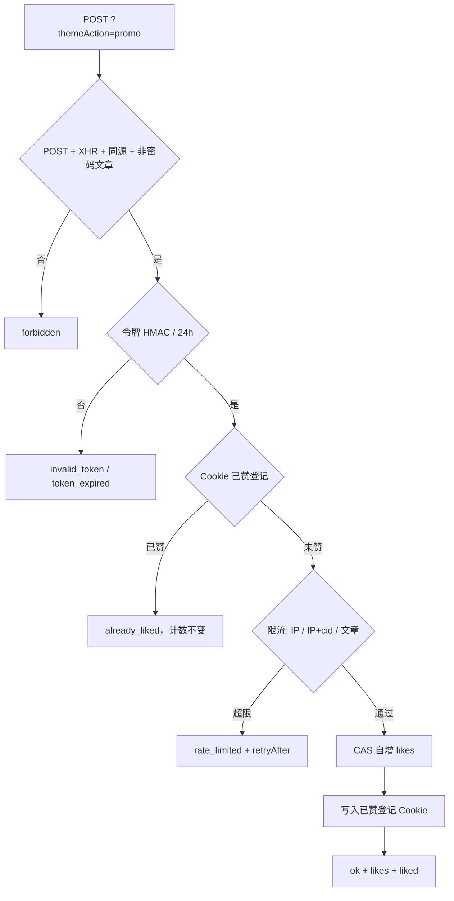

# 文章点赞功能优化方案

> 状态：方案已定稿，待实施（决策项已确认：不引入伴生插件、浏览器维度去重、阈值用常量、删除 `dec`）
> 涉及文件：[src/functions/api.php](src/functions/api.php)、[src/functions/utils.php](src/functions/utils.php)、[src/modules/article-tool/](src/modules/article-tool)、[src/api/](src/api)
> 约束：MySQL / PostgreSQL / SQLite 三库通用，零原生 SQL，**不新增数据表**，不引入 PHP 第三方依赖

## 一、原始诉求

文章左侧的点赞按钮位于 [src/modules/article-tool/](src/modules/article-tool)，点击后调用主题的点赞接口计数。该接口实现粗糙，需要优化：

1. 如何防止同一用户对同一篇文章重复点赞。
2. 如何防止访客对同一篇文章重复点赞。
3. 如何防止恶意刷赞。
4. 如何对点赞接口进行限流。

## 二、现状与问题

请求链路：

1. 模板 [article-tool.php](src/modules/article-tool/article-tool.php:3) 输出 `.article-like-btn`，`badge` 取自 `getLikeCount($this)`。
2. 前端 [index.ts](src/modules/article-tool/index.ts:52) 调用 [postLike()](src/api/article.ts:36)：`POST {文章URL}?themeAction=promo&operate=inc&field=likes`。
3. 服务端 [utils.php](src/functions/utils.php:933) `themeInit()` 命中 `themeAction=promo` 后进入 [promo()](src/functions/utils.php:220)，对 `table.fields.likes` 做 `get/set/inc/dec`。

| 类别   | 问题                                                                                               |
| ------ | -------------------------------------------------------------------------------------------------- |
| 安全   | 暴露 `set`/`dec` 且 `value` 任意可传 → 任何人可把点赞数写成任意值或清零                            |
| 安全   | `field` 无白名单（`$allowFields` 定义了却没用）→ 可改 `thumb` 等其他自定义字段                     |
| 安全   | 无来源校验、无令牌、无频率限制 → `curl` 一行命令即可刷                                             |
| 正确性 | `inc` 是「读-改-写」，并发下丢计数                                                                 |
| 正确性 | 未校验文章状态，可向任意 cid 写入 `table.fields` 垃圾行                                            |
| 正确性 | `status` 恒为 1，前端异常分支永远走不到                                                            |
| Bug    | `parseFields()` 用 `get_object_vars()` 读 `Typecho\Config` 恒为空 → Typecho 1.3 下点赞数一直显示 0 |
| 体验   | 模板用「文章有赞」决定 `active` → 所有访客一进文章按钮就高亮，无法表达「我赞过」                   |

## 三、方案总览



层次：**准入 → 令牌 → 去重 → 限流 → 原子计数**。最贵的写库放最后；前端只负责表现与回滚。

覆盖范围：文章页（`is('single')`）与独立页（`is('page')`），两处模板都渲染了点赞按钮，接口需同时支持。

## 四、去重方案（诉求 1、2）

身份只认浏览器，不引入访客表：

- 签名 Cookie `__jj_likes`：值为 `cid1,cid2,...<最近 100 个>.<HMAC>`，用 `Typecho_Cookie` 读写（自动带站点前缀）。
- 首次点赞成功后才写入登记；重复点赞直接返回 `already_liked`，不碰数据库。
- 服务端渲染时用同一 Cookie 决定按钮初始态（`active` / `data-liked` / `aria-pressed`）。
- Cookie 只保留最近 100 篇文章，避免无限膨胀；签名只防手工篡改，不承担安全边界。

有意接受的取舍：清 Cookie 后可再次点赞，由限流兜底；不新增表、不做设备级绑定。

**为什么不把明细入库**（已逐项评估）：

1. `table.fields` 每个点赞者一行不可行：Typecho 1.3 `var/Widget/Base/Contents.php::___fields()` 每次访问 `$archive->fields` 都会把该 cid 的所有字段行全量取回，热门文章会拖垮列表页。
2. 主题没有安装/激活钩子，无法建表；懒建表要手写三套 DDL，违反「零原生 SQL」。
3. 写 `table.options` 会污染每次请求都加载的全局 options 缓存。

## 五、防刷（诉求 3）

### 5.1 准入校验

1. 必须 POST 且 `X-Requested-With: XMLHttpRequest`（axios 已默认携带）。
2. 带了 `Origin`/`Referer` 就必须与 `siteUrl` 同域；都没带则交给令牌把关（避免 `no-referrer` 站点误伤）。
3. `User-Agent` 非空。
4. cid 只取路由解析结果，**不接受请求参数**；密码保护文章直接拒绝。
5. 只保留「加一」语义，`operate`/`field`/`value` 一律不再读取。

### 5.2 页面令牌

- 模板输出 `data-token = 时间戳.HMAC(cid|时间戳)`，有效期 24 小时，签名密钥由站点路径 + siteUrl 派生（不落盘、多机一致）。
- 令牌不含 Cookie，因此页面仍可被 CDN 缓存；重放由去重 + 限流兜住（一次性 nonce 需要服务端存储，v1 不做）。
- 不设最小停留时间：真实用户可能秒点，误拒成本高于收益。

### 5.3 可疑行为日志

命中限流、令牌非法、来源不符时写一条 `error_log`：`reason`、`cid`、IP 哈希（不落原始 IP）、等待秒数。只记关键事件，不做逐请求日志。

## 六、限流（诉求 4）

只保留三条规则，够用且不啰嗦：

| 维度                                     | 阈值  | 窗口    |
| ---------------------------------------- | ----- | ------- |
| 单 IP                                    | 10 次 | 5 分钟  |
| 单 IP + 文章（换 Cookie 刷的主要拦截点） | 1 次  | 10 分钟 |
| 单文章                                   | 60 次 | 1 小时  |

实现：

- 存储：`sys_get_temp_dir()/jj-like-<hash>/<sha1(key)>.json`，`fopen` + `flock` 串行化，固定窗口到期重置。
- 临时目录不可写时**直接放行**并保留点赞可用性（宁可不限流，也不误伤正常点赞）。
- `retryAfter` = 窗口剩余秒数，前端据此倒计时。

真实 IP：

- 直连公网时只认 `REMOTE_ADDR`（Typecho 的 `Request::getIp()` 无条件信任 `X-Forwarded-For` 首段，可伪造）。
- `REMOTE_ADDR` 为内网/回环（本机 Caddy 反代即此类）时，取 `X-Forwarded-For` 中最右侧公网地址。

## 七、计数正确性

CAS 条件更新，用影响行数判断是否抢到写权限：

```php
UPDATE fields SET str_value = <当前值+1>
WHERE cid = ? AND name = 'likes' AND str_value = <当前值>
```

- 无记录时插入；唯一键冲突说明被并发插入，退避后转更新分支。
- 冲突重试最多 15 次，2~8ms 抖动；仍失败返回 `server_error`，前端提示稍后重试（计数不会丢或翻倍）。
- 上限 `999999`，防止被刷到溢出。
- 继续用 `str_value` + `intval()`，避免三库数值行为差异。

## 八、接口契约

请求：`POST {文章地址}?themeAction=promo`，表单编码，仅需 `token`。

| 字段         | 类型   | 说明                                                                                                       |
| ------------ | ------ | ---------------------------------------------------------------------------------------------------------- |
| `status`     | 0/1    | 旧字段，1=成功（含已赞），保留兼容                                                                         |
| `code`       | string | `ok` / `already_liked` / `rate_limited` / `token_expired` / `invalid_token` / `forbidden` / `server_error` |
| `msg`        | string | 用户提示语                                                                                                 |
| `likes`      | int    | 当前点赞总数                                                                                               |
| `liked`      | bool   | 当前浏览器是否已赞                                                                                         |
| `retryAfter` | int    | 仅限流时有值                                                                                               |
| `result`     | string | 旧格式 JSON，保留兼容                                                                                      |

HTTP 恒为 200：应用层错误用 `code` 表达，避免与 [request/index.ts](src/request/index.ts) 拦截器「非 200 一律弹 toast」冲突。

## 九、前端改动

- [article-tool.php](src/modules/article-tool/article-tool.php)：输出 `data-cid` / `data-count` / `data-liked` / `data-token`，`active` 与 `aria-pressed` 按服务端结果渲染；`getLikeCount()` 只调用一次。
- [index.ts](src/modules/article-tool/index.ts)：
  - 已赞时点击本地拦截，不发请求；
  - `likeBusy` 锁防连点；
  - `rate_limited` 按 `retryAfter` 冷却（按钮降透明度），到期自动解锁；
  - 失败提示用服务端 `msg`，不篡改已渲染计数；
  - 支持 Enter / Space（`role="button"`）。
- [style.scss](src/modules/article-tool/style.scss)：新增 `.like-cooldown` 冷却态。
- [article.ts](src/api/article.ts)：`postLike(url, token)`，表单编码提交；[types.ts](src/api/types.ts)：新增 `LikeCode` 并扩展 `LikeResult`。

## 十、代码落点

| 文件                                      | 改动                                                                                                                                                                                                                                                            |
| ----------------------------------------- | --------------------------------------------------------------------------------------------------------------------------------------------------------------------------------------------------------------------------------------------------------------- |
| [api.php](src/functions/api.php)          | 新增点赞段：`jjLikeSecret` / `jjLikeToken` / `jjLikeVerifyToken` / `jjLikeLikedCids` / `jjLikeHasLiked` / `jjLikeRemember` / `jjLikeClientIp` / `jjLikeSameOrigin` / `jjLikeRateLimit` / `jjLikeIncrement` / `jjLikeRespond` / `jjHandleLikeRequest` + 4 个常量 |
| [utils.php](src/functions/utils.php)      | 删除旧 `promo()`；`themeInit()` 改调 `jjHandleLikeRequest()`（含 page）；修复 `parseFields()` 对 `Typecho\Config` 的解析（改用 `iterator_to_array`）                                                                                                            |
| [article-tool/](src/modules/article-tool) | 模板 `data-*`、初始态、TS 状态机、冷却样式                                                                                                                                                                                                                      |
| [api/](src/api)                           | `postLike(url, token)` 与响应类型                                                                                                                                                                                                                               |

不改动：`theme-config.php`（不新增设置项，阈值以常量集中管理）、`getLikeCount()` 与各列表卡片调用。函数统一 `jjLike` 前缀，避免与 `utils.php` 和第三方重名。

## 十一、验证清单

三套 compose 环境（sqlite / mysql80 / pgsql）各跑一遍，结果需一致：

| 用例                                | 期望                      |
| ----------------------------------- | ------------------------- |
| 正常点赞                            | `ok`，计数 +1             |
| 重复点赞                            | `already_liked`，计数不变 |
| 刷新页面                            | 计数正确，按钮保持已赞态  |
| 缺令牌 / 伪造令牌                   | `invalid_token`           |
| 25h 前令牌                          | `token_expired`           |
| 同 IP 换 Cookie 再点                | `rate_limited`            |
| 无 `X-Requested-With` / 跨站 Origin | `forbidden`               |
| 独立页点赞                          | `ok`                      |
| 旧参数 `operate=set&value=99999`    | 被忽略，最多 +1           |
| 10 进程并发自增（新增行 / 已有行）  | 恰好 +10，无丢失无重复    |

其他：

- 容器内 `php -l`、`tsc --noEmit`、`pnpm build` 通过，构建末端无乱码告警。
- 产物同步 `docker/themes/Typecho_Theme_JJ` 后刷新页面联调。

## 十二、已知限制

1. 清 Cookie 可再赞：受 IP+cid（10 分钟 1 次）、单 IP（5 分钟 10 次）、单文章（1 小时 60 次）三层约束。
2. 同一账号多设备各能赞一次：需要服务端明细表，主题层建不了表，不做。
3. 多机部署时限流按节点独立计数：共享存储超出主题范围。
4. 令牌在有效期内可重放：先撞已赞去重，去重失效时再撞限流。
5. NAT 出口多人共享 IP 额度：`ip:cid` 只限制 1 次/10 分钟，正常场景不会误伤。

## 十三、不做的事（范围外）

- 伴生插件 + 独立表（精确的账号级去重、后台明细、封禁 UI）。
- 验证码 / 第三方风控（Turnstile、极验）：需外部依赖与密钥管理。
- 取消点赞（`dec`）：UI 无入口，端点能力一并移除；将来要做需独立配额与去重键。
